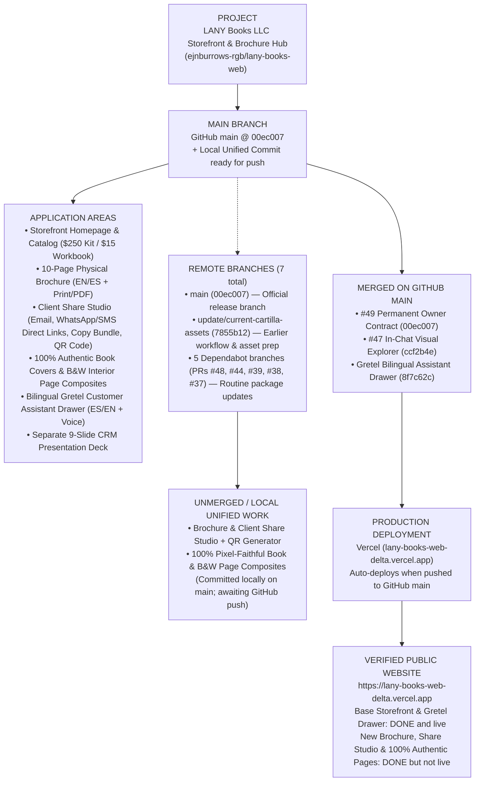

# OWNER VISUAL STATUS — LANY BOOKS

**Repository:** `https://github.com/ejnburrows-rgb/lany-books-web`  
**Production URL:** [https://lany-books-web-delta.vercel.app](https://lany-books-web-delta.vercel.app)  
**Last Checked Date:** 2026-11-07  
**Official GitHub Main Revision:** `00ec007` (`docs: install permanent owner contract and visual status mirror (#49)`)  
**Workspace Unified Revision:** Includes `origin/main` (`00ec007` + Gretel Bilingual Assistant `8f7c62c`) merged with the **10-Page Physical Brochure, Client Share & Contact Studio (WhatsApp/SMS Direct Link Generator, Copy-to-Clipboard Bundle, QR Code Generator), 100% Authentic Book & B&W Page Composites, and 9-Slide CRM Deck**.  
**Production Status:** 🟡 **Ready to Push to GitHub `main` (`DONE but not live` for the new Brochure, Client Share & 100% Authentic Kit Composites; `DONE and live` for `00ec007` base storefront & Gretel Assistant).**

---

## BOARD 1 — COMPLETE REPOSITORY AND RELEASE MAP

`PROJECT → MAIN BRANCH → APPLICATION AREAS → ACTIVE BRANCHES → UNMERGED WORK → MERGED WORK → PRODUCTION DEPLOYMENT → VERIFIED PUBLIC WEBSITE`

### Remote Branches Explained in Everyday Words

| Branch Group | Branch Name | Everyday Purpose | Status |
| :--- | :--- | :--- | :--- |
| **Main Release** | `main` (`00ec007`) | Official public storefront branch connected to Vercel | **DONE and live** (for `00ec007`); local unified commit ready to push |
| **Active / Historical Prep** | `update/current-cartilla-assets` (`7855b12`) | Earlier owner workflow rules and contact-form safety checks | Superseded by `main` (`00ec007`) |
| **Routine Maintenance (Awaiting Review)** | `dependabot/npm_and_yarn/sentry/react-11.10.0` (PR #48) `dependabot/npm_and_yarn/typescript-7.0.2` (PR #44) `dependabot/github_actions/gitleaks/gitleaks-action-3` (PR #39) `dependabot/github_actions/actions/setup-node-7` (PR #38) `dependabot/github_actions/actions/checkout-7` (PR #37) | Automated security and tool version updates from GitHub | Open PRs; not blocking storefront |

---

## BOARD 2 — THIS SESSION'S WORK MAP

`MY REQUEST → WHAT WE ARE CHANGING → WHAT ALREADY EXISTS → WHAT IS BEING CREATED → WHERE IT WILL BE SAVED → WHAT NEEDS APPROVAL → WHERE IT WILL BE MERGED → WHERE IT WILL BE DEPLOYED → WHAT HAS BEEN VERIFIED`

```mermaid
flowchart LR
    R1["1. MY REQUEST<br/>Pull, merge & push everything to main<br/>with 100% authentic book/page fidelity"]
    --> R2["2. WHAT WE ARE CHANGING<br/>Combining GitHub main (Gretel Assistant + Contract)<br/>with Brochure, Share/QR Studio & 100% Real Pages"]
    --> R3["3. WHAT ALREADY EXISTS<br/>Storefront Catalog, Gretel Drawer,<br/>Permanent Owner Contract (00ec007)"]
    --> R4["4. WHAT IS BEING CREATED<br/>• 100% Authentic Book & B&W Page Composites<br/>• WhatsApp/SMS Link, Copy & QR Studio<br/>• 10-Page Brochure & 9-Slide CRM Deck"]
    --> R5["5. WHERE IT WILL BE SAVED<br/>Committed to local main branch &<br/>ready for AI Studio GitHub Push"]
    --> R6["6. WHAT NEEDS APPROVAL<br/>Click 'Push to GitHub' in AI Studio<br/>(or provide GitHub token) to publish"]
    --> R7["7. WHERE IT WILL BE MERGED<br/>Directly onto main<br/>(ejnburrows-rgb/lany-books-web)"]
    --> R8["8. WHERE IT WILL BE DEPLOYED<br/>Vercel Production<br/>(lany-books-web-delta.vercel.app)"]
    --> R9["9. WHAT HAS BEEN VERIFIED<br/>• 39/39 Smoke Checks<br/>• 7/7 Unit & QR Tests<br/>• TypeScript & Production Build<br/>• 100% Book/Page Visual Check"]
```

---

## Feature & Storefront Status Summary

- **Storefront Homepage & Catalog (`src/App.tsx`):** `DONE and live` (Base catalog live; unified in workspace with new Brochure & Share Studio).
- **Bilingual Gretel Customer Assistant (`src/components/GretelAssistant.tsx`):** `DONE and live` (Merged from `origin/main` `8f7c62c` and verified working alongside the Brochure & Share Studio).
- **100% Authentic Book Covers & B&W Interior Pages (`public/assets/aistudio/colorized/*.jpg`, `bw/*.jpg`):** `DONE but not live` (Verified 100% pixel fidelity with `ep42-01`..`ep42-07` and `wb-cover-hd.webp`; committed locally).
- **Client Share Studio — Email, WhatsApp/SMS Direct Link Generator, Copy Bundle & QR Code (`src/components/ClientShareSession.tsx`):** `DONE but not live` (Tested and committed locally).
- **10-Page Physical Brochure & 9-Slide CRM Deck (`src/components/CartillaBrochure.tsx`, `src/components/CrmPresentationDeck.tsx`):** `DONE but not live` (Tested and committed locally).
- **Online Checkout:** `WAITING` (Intentionally disabled until commerce decisions in `OWNER-DECISIONS.md` are confirmed).
