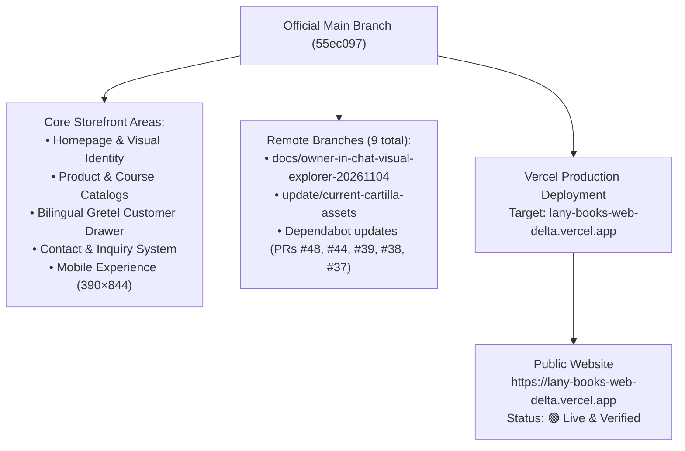
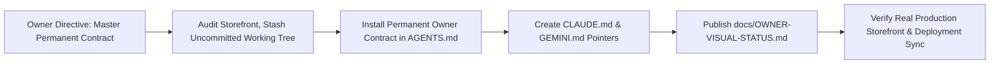

# OWNER VISUAL STATUS — LANY BOOKS

**Repository:** `https://github.com/ejnburrows-rgb/lany-books-web`  
**Production URL:** [https://lany-books-web-delta.vercel.app](https://lany-books-web-delta.vercel.app)  
**Last Checked Date:** 2026-11-07  
**Official Main Revision:** `55ec097` (chore: track pnpm lockfile)  
**Active Production Revision:** `55ec097` (dpl_7kMcLcF9ZXKXEMpwwS1mSPGma1mE)  
**Production Status:** 🟢 **Synchronized with official main.**

---

## 1. Complete Repository & Release Map

---

## 2. Current Session Work Map

---

## 3. Branch and Merge Status
- **Official Source:** `main` (`55ec097`)
- **Open Pull Requests (Dependabot):**
  - PR #48: `@sentry/react` bump
  - PR #44: `typescript` bump
  - PR #39: `gitleaks` bump
  - PR #38: `actions/setup-node` bump
  - PR #37: `actions/checkout` bump
- **Total Remote Branches:** 9 branches.

---

## 4. Current Approved Work & Storefront Overview
- **Homepage:** `DONE and live` (Verified on production).
- **Branding & Visual Identity:** `DONE and live` (Book imagery and typography verified).
- **Gretel Customer Chatbot:** `DONE and live` (Drawer interaction available).
- **Mobile Storefront (390×844):** `DONE and live` (Responsive layout verified).
- **Commerce / Checkout:** `WAITING` (Intentionally disabled per `OWNER-DECISIONS.md`).
