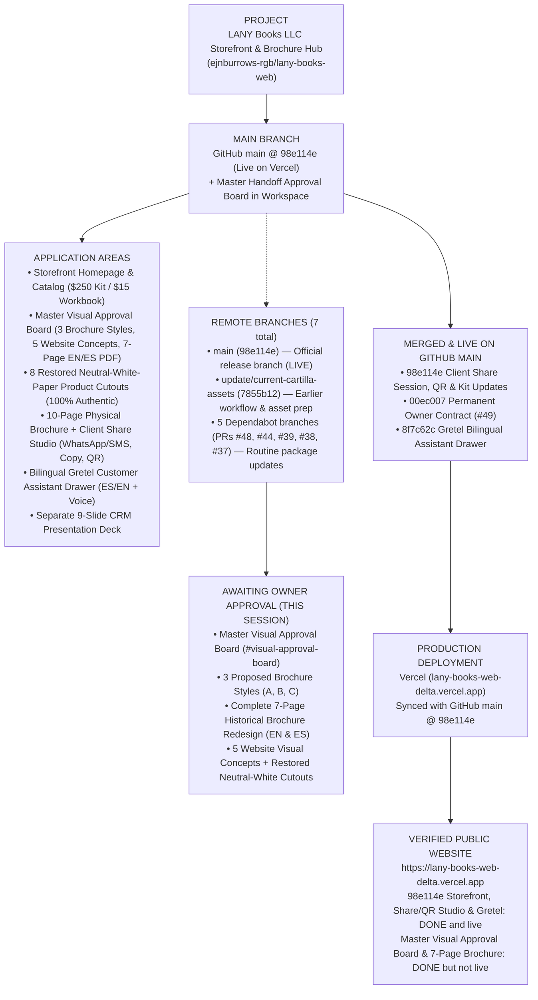

# OWNER VISUAL STATUS — LANY BOOKS

**Repository:** `https://github.com/ejnburrows-rgb/lany-books-web`  
**Production URL:** [https://lany-books-web-delta.vercel.app](https://lany-books-web-delta.vercel.app)  
**Last Checked Date:** 2026-11-08  
**Official GitHub Main Revision:** `98e114e` (`feat: add client sharing session and kit updates`) — **LIVE on Vercel**  
**Workspace Unified Revision:** Includes `origin/main` (`98e114e`) + **Master Handoff: 8 Restored Neutral-White-Paper Authentic Product Cutouts (`public/assets/aistudio/restored/*.png`), 3 Brochure Design Style Options, Complete 7-Page Historical Marketing Brochure Redesign (English & Spanish Editions), 5 Website Visual Concepts with Desktop (`1366×768`) & Mobile (`390×844`) Previews, and Side-by-Side Authenticity Comparison Board**.  
**Production Status:** 🟢 **Base Storefront, 10-Page Brochure & Client Share Studio (`98e114e`) are `DONE and live` on Vercel; Master Visual Comparison & Approval Board + 7-Page Brochure Redesign are `DONE but not live` (ready in preview for owner approval).**

---

## BOARD 1 — COMPLETE REPOSITORY AND RELEASE MAP

`PROJECT → MAIN BRANCH → APPLICATION AREAS → ACTIVE BRANCHES → UNMERGED WORK → MERGED WORK → PRODUCTION DEPLOYMENT → VERIFIED PUBLIC WEBSITE`

### Remote Branches Explained in Everyday Words

| Branch Group | Branch Name | Everyday Purpose | Status |
| :--- | :--- | :--- | :--- |
| **Main Release** | `main` (`98e114e`) | Official public storefront branch connected to Vercel | **DONE and live** on `lany-books-web-delta.vercel.app` |
| **Active / Historical Prep** | `update/current-cartilla-assets` (`7855b12`) | Earlier owner workflow rules and contact-form safety checks | Superseded by `main` (`98e114e`) |
| **Routine Maintenance (Awaiting Review)** | `dependabot/npm_and_yarn/sentry/react-11.10.0` (PR #48) `dependabot/npm_and_yarn/typescript-7.0.2` (PR #44) `dependabot/github_actions/gitleaks/gitleaks-action-3` (PR #39) `dependabot/github_actions/actions/setup-node-7` (PR #38) `dependabot/github_actions/actions/checkout-7` (PR #37) | Automated security and tool version updates from GitHub | Open PRs; not blocking storefront |

---

## BOARD 2 — THIS SESSION'S WORK MAP

`MY REQUEST → WHAT WE ARE CHANGING → WHAT ALREADY EXISTS → WHAT IS BEING CREATED → WHERE IT WILL BE SAVED → WHAT NEEDS APPROVAL → WHERE IT WILL BE MERGED → WHERE IT WILL BE DEPLOYED → WHAT HAS BEEN VERIFIED`

```mermaid
flowchart LR
    R1["1. MY REQUEST<br/>Master Handoff: Authentic Product Restoration,<br/>7-Page Brochure Redesign & 5 Website Concepts"]
    --> R2["2. WHAT WE ARE CHANGING<br/>Adding Visual Comparison & Approval Board<br/>without replacing live hero before approval"]
    --> R3["3. WHAT ALREADY EXISTS<br/>Live Storefront (98e114e), Official Logo,<br/>Blue Cover & ep42-01..07 Source Scans"]
    --> R4["4. WHAT IS BEING CREATED<br/>• 8 Neutral-White Restored Cutouts<br/>• 3 Brochure Styles + 7-Page EN/ES Brochure<br/>• 5 Website Visual Concepts (Desktop & Mobile)"]
    --> R5["5. WHERE IT WILL BE SAVED<br/>src/config/masterHandoffData.ts,<br/>src/components/MasterVisualApprovalBoard.tsx,<br/>public/assets/aistudio/restored/*.png"]
    --> R6["6. WHAT NEEDS APPROVAL<br/>Choose Preferred Brochure Style (A/B/C)<br/>& Website Concepts (1–5), then Option A"]
    --> R7["7. WHERE IT WILL BE MERGED<br/>GitHub main<br/>(ejnburrows-rgb/lany-books-web)"]
    --> R8["8. WHERE IT WILL BE DEPLOYED<br/>Vercel Production<br/>(lany-books-web-delta.vercel.app)"]
    --> R9["9. WHAT HAS BEEN VERIFIED<br/>• 39/39 Smoke Checks<br/>• 8/8 Unit & Fidelity Tests<br/>• TypeScript, Lint & Build<br/>• 100% Authentic Cutout Inspection"]
```

---

## Feature & Storefront Status Summary

- **Storefront Homepage, Catalog, Client Share Studio & Gretel Assistant (`98e114e`):** `DONE and live` on `https://lany-books-web-delta.vercel.app`.
- **8 Restored Neutral-White-Paper Authentic Product Cutouts (`public/assets/aistudio/restored/*.png`):** `DONE but not live` (100% pixel-faithful to `wb-cover-hd.webp` and `ep42-01`..`ep42-07` with exterior olive-green `rgb(155,172,106)` borders and scan yellowing removed).
- **Master Visual Comparison & Approval Board (`src/components/MasterVisualApprovalBoard.tsx`):** `DONE but not live` (Includes 3 Brochure Design Styles, Complete 7-Page Historical Brochure Redesign in English & Spanish with Print/PDF export, 5 Website Visual Concepts with Desktop `1366×768` & Mobile `390×844` switcher, and Side-by-Side Original vs. Restored Authenticity Comparison).
- **Online Checkout:** `WAITING` (Intentionally disabled until commerce decisions in `OWNER-DECISIONS.md` are confirmed).
